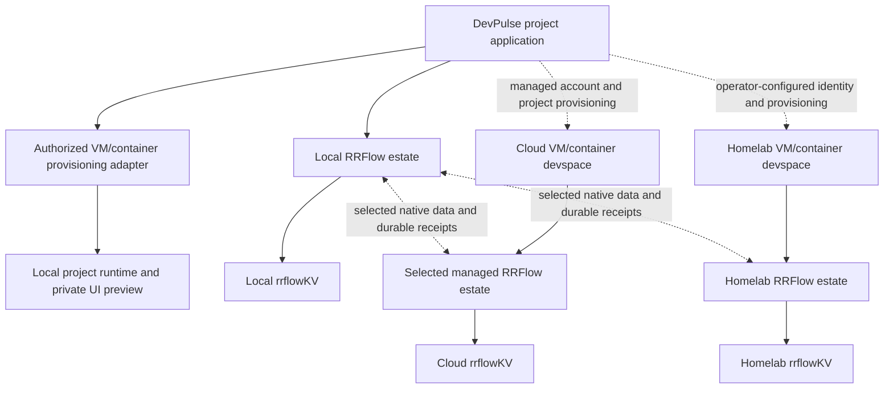

# DevPulse project runtimes and bidirectional cloud or homelab synchronization

**Status:** active integration contract; local native database path exists, account synchronization is not implemented
**Coordinate:** `rrflow://rrflow-instance/data/reference/client/devpulse-cloud`
**Owner:** DevPulse project-runtime integration and explicit bidirectional managed-cloud or self-hosted synchronization boundary

DevPulse will include the local RRFlow reasoning engine and its native rrflowDB.
Installation, local queries, durable writes, recovery and local reasoning that
uses an installed model must not require a shippin.cloud account. Hosted model
calls remain separately authorized provider capabilities. The
[local integration guide](../sdk/rrflowdb-local.md) provides a runnable native
database path now. It is not yet a packaged DevPulse application.

DevPulse is the owner's project development application. The required product
experience includes provisioning local VMs or containers for projects, running
their toolchains and UIs, and integrating each project with RRFlow. A user can
stay local, select an admitted managed service, or connect to an
operator-controlled homelab. Both remote choices must support explicitly
selected bidirectional synchronization; remote access alone enables no transfer. A
hosted account is not a prerequisite for local or homelab operation.

The available Windows development engine/Connectome bundle proves only the
bounded local behavior in its receipt. It is not a qualified DevPulse package,
managed database service, sync implementation, or competitive parity result.

## Optional managed service roles

The owner-directed delivery targets distinguish the following roles. These
names describe intended experiences, not verified domain ownership, deployed
endpoints, account federation or available service APIs:

| Experience | Planned role | Independent qualification |
|---|---|---|
| Local RRFlow and Connectome | Open-source engine with one estate per project, usable without an account. Connectome offers guided operation and learning from visible evidence. | D-01/C-07 and H-06/J installed product and client acceptance. First-party licence texts/notices remain a J-05/POAM-013 release requirement. |
| rrflow.ai | The hosted reasoning engine: optional managed access to hosted project engines, explicitly selected synchronization including access from another authorized device, and the evidence views below. | H-07 account, instance, transfer and real-service acceptance; remote access is not proof of two-way synchronization. |
| rroflow.ai | The learning service: optional supervised, unsupervised and recursive learning over authorized datasets, experiments and qualified improvement artifacts, exposed through Connectome with the learning-results view. | G-06/I-03/I-07 learning acceptance plus H-07 transfer/account controls for selected data. Upload and artifact activation require distinct authorization. |
| shippin.cloud | First hosted destination for local RRFlow bidirectional synchronization and managed project engines/data; also the private development space for toolchains, containers/VMs and UI previews. | H-07a/b/c/d/g identity, engine distribution and real sync acceptance; H-07e/f adds the distinct devspace and file/environment proof. A synchronized database is not a working devspace. |
| Operator-controlled homelab | Self-hosted engine and optional development/learning capabilities under the same admitted public profiles, including self-hosted rrflow.ai and rroflow.ai service software. | Independent identity, recovery and transfer qualification with managed services unavailable. |

By the repository owner's direction of 2026-10-24, the rrflow.ai and rroflow.ai
service software is open source and self-hostable, like the engine and
Connectome. An operator can run the same service software on their own
infrastructure and receive the same evidence views and learning capabilities
without a managed account. The managed offering adds operation by the service
owner; it does not add proprietary engine, learning, or evidence behavior.
The licensing approach and the source location of the service software are not
yet decided.

### Nomen identity and delivery priority

By the repository owner's direction of 2026-10-25, **Nomen is the central
identity manager and login for all products**, including RRFlow, Connectome,
DevPulse, shippin.cloud, rrflow.ai and rroflow.ai. This is the shared identity
target, not evidence of an available account service or implemented integration.
Nomen's authoritative protocol, issuer/trust model, client registration,
credential lifecycle and supported deployment profiles must be obtained from
its owning implementation before authoring an adapter; do not invent endpoints
or assume a protocol from the product name.

Delivery order is a working local engine, then opt-in local-to-shippin.cloud
bidirectional synchronization using Nomen login, then qualification of additional
custom/self-hosted service profiles through the same configurable boundaries.
Hosted engines can store and operate project estates on shippin.cloud; local
replication and remote-only access are separate choices. This priority does not
remove local-only, cloud-hosted or custom deployment targets, or postpone local
engine correctness behind cloud work. No account is required for local use.

The nontechnical setup offers to share the selected project's data and access
with the user's chosen services and AI tools. One understandable confirmation
can authorize that selected set; the client derives and applies the underlying
service/project bindings. Do not require the user to configure each grant or
reapprove unchanged authorized operations. Shared login identifies the user;
remembered sharing choices determine which bindings can activate automatically.
Nomen identity is distinct from the engine's
[durable seat identity](../seat-identity.md), estate identity and transaction
authority. Binding an account must not replace those identities, silently merge
estates, enable cross-project context sharing or grant training/provisioning
permission. Credentials must be validated for their intended service and scope;
account binding, expiry, rotation and revocation must have explicit outcomes.

Use configured endpoint profiles, trust and credential references rather than
hardcoded domains in engine or client dispatch. Show the actual service,
account, destination estate and synchronization state for each operation.
Central login never implies access to every product's data. Custom deployments
must declare their supported identity/trust profile; no managed Nomen service
may become an undeclared dependency of local or homelab operation. Unknown or
unsupported service/identity profiles remain unavailable. Loss of cloud login
must stop unauthorized remote work while preserving local data and operation.

Connectome automatically connects to the installed or previously selected local
instance using its existing authenticated installation binding. It offers cloud
sync and sharing with connected services as part of the project setup, including
rrflow.ai access and a later rroflow.ai recursive-learning extension. A single
setup screen presents useful presets, selected recipients, what they can read or
do and any cost; advanced grant details stay expandable. After the user chooses,
create the necessary bindings and maintain them automatically. Data sharing,
sync, learning and provisioning have distinct recorded effects, but they do not
require separate dialogs when the setup choice already covers them.

Reuse a valid Nomen session and saved connector authorization automatically.
Refresh/resume through the supported contract; request sign-in only when it is
actually needed, then return to the pending setup or transfer. Resume approved
sync from its acknowledged checkpoint after restart or network recovery. A new
installation offers sharing before sending project data; a returning installation
restores its saved choices rather than behaving as an unconfigured install.
Changed account, recipient, scope or cost requires only the changed decision.
Local operation remains usable if cloud/identity/connector access is unavailable.

### Existing AI subscriptions and practical delivery

Offer Claude, Codex and other admitted frontier-AI tools in the same setup flow.
Detect a supported installed client/session through its documented interface,
show the account and access/billing mode, and guide only missing connection
steps. Where a provider supports it, expose the selected RRFlow project through
its connector/MCP/tool integration so the user's existing subscription client
can consume grounded context. Nomen coordinates RRFlow product identity and
connection state; it does not itself issue third-party subscription entitlement.
Do not copy third-party credentials between services to simulate shared login.

Qualify each adapter against its actual provider contract. Official
[Codex authentication](https://developers.openai.com/codex/auth) distinguishes
ChatGPT sign-in from API-key access. Official
[Claude account authentication](https://support.claude.com/en/articles/13189465-log-in-to-your-claude-account)
distinguishes native subscription use from third-party access and billing.
These are inputs to adapter design, not evidence that RRFlow already integrates
either. Never silently replace an unavailable subscription path with paid API
calls; show the supported path and any charge before activation.

The first usable release may support a bounded set of clients and sharing
capabilities, then extend it. Record each limitation and improve the adapters
without forcing users to learn credentials, scopes, schema or synchronization
internals. Basic acceptance measures successful setup and recovery with minimal
interaction as well as correct isolation; security work belongs in the adapter,
not a maze of manual setup requirements.

RROFLOW may be prepared and used locally when its capabilities qualify; the
cloud is not a prerequisite for learning. Conversely, a user may choose remote
engine access without consenting to training. The
[learning contract](../inference/learning/controller-training.md#staged-learning-and-feedback)
owns candidate methods and promotion. H-07 may develop independently of Gate I;
the combined learning-service experience requires both accepted boundaries.

Every destination presents the same four evidence views that
[OBJ-11](../../objectives/rrflow-1.0-alpha.md#required-outcomes) measures:
retrieval hits, usage and savings, learning results, and the project's stored
data. Local Connectome, the homelab and the managed services read them from
engine-owned records through public operations at an exact read stamp. A
service computes no separate truth, and a savings figure without a declared
baseline method is shown as unknown. Views and metrics are configurable.
Operators extend them with versioned, authorized, removable definitions, and
an extension cannot read outside its grant or change engine records.

### Turnkey rroflow.ai handoff

rroflow.ai remains an optional learning destination, not a default indexing
prerequisite. Under Connectome's existing Learning and Services areas, separately
show local engine readiness, account binding, authorized dataset transfer,
remote experiment state, returned artifact verification and local activation.
Logging in, transferring a project or opening a cloud page proves none of the
later states. Local work remains usable when the service is disabled or offline.

The required H-07/G/I sequence is: configure and authenticate an endpoint with
expected account/service identity; preview the exact allowed project datasets
and purposes; authorize transfer; resume by durable checkpoint; receive a
source/model/configuration-bound candidate; verify held-out evaluation; preview
and authorize promotion. Upload consent, training consent and activation consent
are distinct. Supplied endpoints are configured and authenticated, never inferred
as trusted just from the displayed `rroflow.ai` name. Credentials remain secret
references; raw private model reasoning is not a dataset.

Prove the flow against a real admitted service and separately against the
supported self-hosted profile: offline retry, duplicate/lost ACK, source deletion,
revoked consent, foreign account, interrupted transfer, stale candidate, failed
quality gate, competing promotion and rollback. Revoke prevents further export
and candidate activation; remote deletion/retention acknowledgement is explicit,
not inferred from local deletion. A returned candidate cannot overwrite local
active settings or a running job silently. Show exact receipts and unresolved
remote outcomes. No current service integration or bidirectional sync is claimed
by this specification; H-07 plus G-06/I-03/I-07 own its acceptance.

## Guided installation and Windows-first DevPulse

DevPulse ships first on Windows and bundles the qualified RRFlow artifact and
its public-contract identity. Standalone RRFlow with the optional Connectome
desktop must also offer guided installation on Windows, macOS and Linux.
These are release requirements; the current development bundle does not yet
prove clean-machine installation on all three platforms.

The normal flow is **Install → Choose or create a project → Start**. Advanced
configuration remains available without making compiler, CLI, database,
provider or container knowledge a prerequisite. Show one understandable
summary of the selected project, local data location, permissions and resource
budget before applying the engine's exact installation plan. Progress and
errors must describe the next useful action. The UI never invents readiness:
it verifies the installed engine, catalogue identity and authenticated session.

Docker is a project-runtime capability managed by DevPulse, never a
prerequisite for RRFlow readiness. When a project's declared runtime needs
containers, first detect an existing compatible runtime and offer its reuse.
If missing, explain the download, runtime/backend, disk requirement,
permissions and applicable terms, then let the user authorize guided setup.
Use a reviewed version/publisher/checksum manifest, invoke the supported
installer directly, and verify the running daemon and a bounded project build
or run before reporting success. Never silently accept third-party agreements,
change host virtualization settings, or mount another project's data.

On Windows, prefer the supported per-user Docker Desktop path with WSL 2 when
it fits the project. Installing Docker itself may not require elevation, while
enabling missing OS features can. Detect unsupported hardware, disabled
virtualization, an unavailable WSL backend, administrator denial and required
restart as distinct states. Save setup progress and revalidate after restart;
do not repeat completed installation or report a running project early.
Platform requirements must be checked against the selected installer release.
[Docker Windows installation](https://docs.docker.com/desktop/setup/install/windows-install/)
and [Microsoft WSL installation](https://learn.microsoft.com/en-us/windows/wsl/install).

Docker/WSL provisioning is a separately authorized DevPulse host effect;
`rrflow install apply` continues to use only the acquired RRFlow bundle.
Container placement, isolated engine instances, context-sharing consent and
cloud synchronization remain separate settings. A shared Docker daemon does
not authorize shared credentials, storage mounts or AI context.

Acceptance belongs to D-01/H-06 for guided engine/client installation, H-07
for DevPulse project-runtime adapters, and J for qualified distribution.
Clean-machine fixtures must cover all declared OS/architecture targets,
signed/publisher-verified acquisition, default local startup without an account
or Docker, existing-project preservation, canceled setup, retry, update and
ownership-safe removal. Windows-first DevPulse additionally proves Docker
already present/missing, WSL missing, denied elevation, restart/resume,
offline/interrupted acquisition, engine-ready/runtime-not-ready distinction,
and a real containerized project whose UI opens privately. Cloud opt-in stays
off throughout these local tests.

## First-run comparison and optional free-tier experience

This is an owner-directed delivery requirement, not an available service or a
claim of improvement for every task. After installed readiness, Connectome must
offer a bounded first useful task and an explicitly selected background
health/soak workload. Show what each runs, its duration, CPU/RAM/disk/network
and model-call limits, progress, stop state and retained result. A first answer,
a short health check and an accepted C-07 endurance campaign are different
results. Do not delay ordinary use until a qualification soak finishes or
present a short check as 24-hour evidence. An operator can choose a lighter
profile; a performance claim remains bound to the profile actually measured.

For each project, show **available**, **configured** and **enabled** separately
for local retrieval, each knowledge path, LFG analysis, SWAG routing, RROFLOW
learning and hosted capabilities. Show the effective revision, field origins,
remaining budget and a concrete unavailable reason. Discovery, a subscription,
an installed model, sign-in or a high-complexity prompt does not activate an
adapter. LFG observations may inform SWAG's qualified policy only within the
accepted user effort ceiling. Missing required analysis must cause an explicit
abstention; it cannot silently escalate effort, send data elsewhere or fabricate
a complexity score. Configuration, dispatch and failure behavior remain owned
by the [LFG/SWAG contract](../inference/lfg-swag.md); learning activation and
promotion remain owned by the [learning contract](../inference/learning/controller-training.md).

The comparison view must make the benefit or lack of benefit reviewable:

| Evidence | Required comparison behavior |
|---|---|
| Same task and declared baseline | Bind task/input and authorized code/context identities, model/provider revision, settings, effort budget, evaluation rubric and baseline method. Distinguish a direct-provider baseline from a separately observed subscription-app session; label differing inputs or unavailable controls. Never claim a controlled comparison when those differ. |
| Quality and grounding | Show success/failure and cited source revisions, unsupported or stale evidence and the held-out rubric result. Lower token use alone is not success. Include regressions and inconclusive outcomes. |
| Work and usage | Separate local retrieval/graph/database work, local model inference, controller overhead, web/connector calls and frontier inference. Report observed input/output/cache/reasoning tokens only where the provider supplies them; local bytes, rows, graph traversals or CPU time are not invented model tokens. |
| Time and cost | Include initialization/indexing/maintenance and controller overhead, end-to-end latency and recurring local/cloud resources. Identify actual billed usage, estimates and unknowns separately, with price source/time/currency. A flat-rate subscription cannot be converted into per-call savings without a declared allocation method. |
| Trace and debug | Drill from the lay summary into correlated request/run/attempt IDs, configuration/source/read stamps, admitted route, retrieval contribution, receipts, limits, stop/uncertain states and bounded redacted diagnostic export. Replay of retained evidence must not invoke the provider again. Traces observe execution; they are not hidden model thought or lifecycle authority. |

The user authorizes any additional baseline or shadow provider calls and their
budget before dispatch. Provider subscription access and API entitlement are
distinct; no paid API, browser automation or model access is inferred from a
subscription name. Unavailable usage or an absent baseline stays unknown.
A first-run demonstration may use a declared bundled fixture; it must not be
presented as measured improvement on the user's private project. J-04 owns
repeatable comparative claims, including warm/cold and enabled/disabled
component comparisons at the same authorized snapshot.

The intended shippin.cloud offering includes an optional free-tier experience.
Before enabling it, the configured service must return an authenticated,
versioned entitlement bound to the service/account/project and eligible
capabilities, with finite resource/usage/concurrency limits, validity/reset
semantics and the service's authoritative usage state. Exact commercial limits
are undecided and must not be invented in engine defaults or UI. The effective
admission is the intersection of engine authorization, project/user budgets
and service entitlement. Free service access grants no project sharing,
training export, connector activation, paid upgrade or additional model access.

The UI previews data disclosure, eligible endpoints and remaining allowance.
The service enforces its quotas; a client counter alone is not an enforcement
boundary. Expiry, revocation, exhausted quota, unsupported capability and an
offline or unverifiable entitlement have distinct visible states. A retry,
new session or restart cannot reset consumption. Lost acknowledgements require
receipt-based reconciliation before another possibly charged call. Local work
continues within its own admitted capabilities; there is no automatic paid
fallback, upload or account requirement. Account disconnection preserves local
data and independently authorized local inference.

Acceptance follows existing owners: D-01/D-06 for installation/configuration,
G-01/G-02/G-06 for analysis, routing and shared budgets, H-05/H-06 for public
signals and Connectome, H-07 for actual service admission, I-03/I-07 for learning
and J-04 for comparative evidence. Exercise disabled/missing LFG/SWAG/RROFLOW,
low/high/inconclusive complexity, budget stop, restart, two competing requests
at the last quota unit, expired/revoked/offline entitlement, lost reply and
account switch. Prove no duplicate charge, widened authority or cross-project
data disclosure, and show a negative or unknown comparison honestly. A schema,
mock entitlement, UI switch or successful sign-in does not pass these cases.

## Relationship and authority

This is the target ownership diagram, not an implementation receipt. Dotted
sync and provisioning paths require qualification. Account and workspace grouping remain
outside the engine as defined by the [instance topology](../../architecture/instance-topology.md).
Each endpoint authenticates an exact instance. A cloud account, UI or resolver
cannot become a database authorization or lifecycle authority. Separate local
and cloud instances do not imply an active-active replica or cross-instance ACID.

DevPulse groups corresponding project checkouts and their estates above the
engine. Every estate retains its own project, instance, authorization and local
commit coordinates; a sync binding maps identities between selected peers.
This is distinct from a read-only cross-project link (H-10) and from replication
inside one distributed RRD instance. Neither is a shortcut to bidirectional sync.

## Separate effect boundaries

| Concern | Authoritative operation | Required visible result |
|---|---|---|
| Project runtime | DevPulse calls an explicitly bound VM/container provider with an approved image/toolchain, mounts, ports and CPU/memory/disk budgets. Shippin or the homelab provider owns its infrastructure state. | Provision/start/stop/failure receipts, private UI URL, cancellation and ownership-safe removal. A running VM is not database readiness. |
| Native database state | Public RRFlow synchronization operations validate source identity, authorization, schema, conflicts and the complete atomic write group. | Destination durable receipt, acknowledged source checkpoint, pending/conflicting changes and per-direction lag. A live connection is not synchronized data. |
| Project source/assets | A project-inventory transfer adapter moves explicitly selected files or content-addressed assets, with revisions, exclusions and conflict handling. | Verified manifest/content digests and destination revision. Database convergence alone does not synchronize source files. |
| Environment reconstruction | Versioned environment manifests name runtime/toolchain/images and approved configuration. Target providers recreate them using explicit capabilities. | Reproducible project build/test/run and private UI preview. Live VM memory, host credentials and raw database files are not copied implicitly. |

The same versioned RRFlow implementation is packaged for each supported native
target and service image. Platform-specific binary digests differ; the release
manifest binds them to one revision and supported protocol/profile. DevPulse,
the managed service and the homelab consume those artifacts and public APIs.
They do not embed a new persistence or reasoning implementation. Process
separation keeps project code execution outside the database authority.

## Required user behavior

1. Automatically connect to the installed/selected local engine and open the
   project without requiring cloud sign-in. Restore existing local bindings;
   do not attach to an arbitrary discovered process.
2. Offer sharing with selected services/AI tools and cloud sync. Reuse valid
   Nomen and connector sessions; when needed, offer sign-in/reconnect and return
   to the same project. Offer a custom destination through advanced setup.
3. Show one clear setup summary: project, recipients/cloud instance, data and
   access offered, sync direction and costs. Make exact families, limits,
   exclusions and transfer estimate expandable. One confirmation authorizes
   the displayed sharing/sync bundle; provision its bindings automatically.
   Resume an existing authorized bundle without asking again. Do not upload
   project data from a new offer until the user accepts it.
4. Establish authenticated transport, verify remote protocol/instance/catalogue
   identities, then activate the authorized adapter binding. Never upload the
   local operator credential, token signing key, model-provider secrets, or raw
   database files as an implicit sync mechanism.
5. Display progress, last acknowledged checkpoint, pending local changes,
   conflicts and paused/offline status for each direction independently. Cloud
   or homelab outage leaves local work usable. Do not display "synced" while
   either direction has pending writes, failed receipts or unresolved conflicts.
6. Disconnect disables future transfer and revokes adapter credentials. Local
   data is retained; remote deletion is a separate explicit action.

## Required synchronization mechanics

The following project settings govern selection and placement independently of
the synchronization protocol.

### Project preferences, sharing, and isolation

Project requirements/preferences are versioned governed data. The user-facing
specification may compose these fields, but cannot become a second authority:
`EstateConfiguration` owns effective engine settings, `EndpointProfile` owns
endpoint bindings, H-10 records own project-link consent, H-07 records own sync
consent, and DevPulse/provider records own physical provisioning. Each view
references those identities/revisions and shows proposed versus observed
state.

Use **AI Development Profile** for the user-facing global development
preferences and **AIDevSpec** as the proposed name of their structured,
versioned representation. These are RRFlow product terms, not a claim of an
industry standard or a new executable schema. Project-scoped overrides,
process requirements, testing expectations and model preferences compose
through the existing configuration owners. A global profile is a reusable
input above estates; each estate explicitly accepts a revision. Editing the
profile cannot silently change every project's effective configuration.

Show effective values, origins, precedence, conflicts, proposed changes and
the accepted revision in Connectome. Preserve project-owned instructions;
hard policy and authorization remain independently enforced, and unresolved
mandatory conflicts block the dependent effect. `AGENTS.md` and
provider-specific instruction projections are integration formats, not extra
configuration authorities. [AGENTS.md](https://agents.md/) defines an existing
project instruction format, while [Claude Code memory](https://code.claude.com/docs/en/memory)
documents scoped instructions; neither defines this complete product profile.
Generate or reference authorized projections during the existing
[bootstrap flow](../agent-bootstrap.md#independent-engine-and-project-integration),
with ownership-safe removal and no provider hooks.

Attunement may propose profile updates or learning examples. Acceptance of a
preference is separate from training consent, model activation and cloud
sharing. The [learning contract](../inference/learning/controller-training.md)
owns those distinctions. D-06 owns effective configuration and H-06/H-07 own
its client projections; no profile UI or executable AIDevSpec schema is
implemented by this naming decision.

The UI must present separate choices with explicit scope:

| Choice | Required preview and effect |
|---|---|
| Context sharing | Private by default. Select exact peer projects, readable families/resources, purpose, expiration and revocation. H-10 offer/acceptance establishes the read-only link; common account membership does not imply consent. |
| Data synchronization | Independently select native state, project files and environment transfer, destination and directions under the existing sync contract. Read sharing does not authorize copying, remote writes or synchronization. |
| Execution isolation | Select required isolation level and eligible placement: dedicated VM/microVM, or explicitly permitted containers within a VM in a declared trust group. Show shared kernel/host boundaries, mounts, network/egress, secrets, ports, resource caps and provider enforcement. |
| Cost and capacity | Preview measured/declared CPU, RAM, GPU, storage, warm/idle policy, regional rates and estimated recurring/usage costs with currency and observation time. Unknown prices remain unknown. Apply hard limits before optimizing placement. |
| Models and knowledge sources | Show active versus candidate LFG/SWAG policies and connector requirements, locality, data disclosure, credentials by reference, budgets, health and unavailable reasons from the engine catalogue. |

A sharing graph may inform which placements are candidates, but never selects
placement by itself. Two sharing projects can require separate VMs; two
nonsharing projects may occupy one explicitly allowed trust-group VM with
separate containers and independent estate authorization. Containers sharing a
guest kernel do not provide the same boundary as separate VMs. Untrusted
mutually isolated workloads require an approved stronger isolation profile;
if the provider cannot enforce it, placement fails rather than silently
downgrading to save money.

Optimize only within approved constraints: bin packing, resource reservations,
idle suspension, cold storage and warm pools need measured contention,
wake latency and cleanup evidence. Sharing data never grants host filesystem,
process, network or credential access. Project code cannot mount RRFlow data
directories or management sockets. Account switches and restore must not attach
another project's volume. A VM is also not proof of complete security:
the actual host/guest, sandbox, patching and network controls require provider
qualification. [Firecracker production guidance](https://github.com/firecracker-microvm/firecracker/blob/main/docs/prod-host-setup.md)
is a reference for those controls, not a selected RRFlow dependency.

Show a reviewable proposal and its digest before provisioning or relocation.
User intent, engine admission and provider enforcement produce distinct
receipts; they are not one cross-service transaction. Interrupted provisioning
must reconcile only owned resources. A cost optimization cannot change sharing,
residency, secret access or isolation without a new authorized configuration.
Revoking a link stops subsequent reads; it does not promise to erase previously
exported data or stop a VM. Display these effects separately.

H-07e qualification must exercise all four sharing/separate-or-shared-placement
combinations, foreign-account/volume/network denial, resource exhaustion,
unsupported isolation, relocation interruption and per-project cost accounting.
H-10 supplies actual two-party link/revocation evidence. A UI toggle or
configuration schema does not qualify either behavior.

### Optional login and maintained updates

RRFlow authentication works locally through its configured identity authority.
Offer Nomen account linking and selected service sharing in the guided setup,
alongside custom hosting in advanced settings. Automatically restore valid saved
sessions and authorized connector/sync bindings. Sign-in resumes already
approved work; a new sharing, provisioning or paid-use choice is presented only
when it is not covered by the saved configuration. Hosted identity remains
optional for local readiness. Disconnect leaves local login and data usable.

Publish signed, digest-bound engine and adapter bundles through Gate J's
release mechanism. Preview platform/protocol/schema/format compatibility,
backup and recovery requirements, downtime, permissions and data movement.
Pin an installed version and rollout channel; check/apply updates only under
the configured authorization. No install-time fetch is introduced into the
default offline bundle. Verify the replacement and reopen/health evidence
before routing work to it; retain the old artifact and verified backup.
Do not call binary rollback safe if the new writer changed an incompatible
storage format. Provider-managed API changes likewise invalidate adapter
conformance until the admitted profile is verified again.

### Transfer protocol requirements

Use the engine's typed public mutation, changefeed and receipt capabilities.
Account authentication and user consent authorize a binding; they are not
themselves a replication algorithm. A future sync package must implement:

- a durable, engine-owned binding naming local instance, remote instance,
  managed-account or self-hosted principal reference, both directions,
  schema/profile digest, consent revision and
  revocable credential reference;
- an explicit initial snapshot/checkpoint handoff with bounded batches,
  interruption/restart and detectable retention gaps;
- source identity and original commit identity on every batch, an immutable
  content digest and a destination idempotency key derived from those identities;
- destination authorization and schema/constraint validation through
  `RrdEngine`; ACK only after the destination's durable receipt, and checkpoint
  advancement only after validating that receipt;
- replay deduplication and origin tracking so a downloaded commit cannot echo
  back as a new local change;
- tombstone/delete propagation, schema incompatibility denial and explicit
  rebootstrap when the source checkpoint is no longer retained;
- optimistic base-version conflict detection; concurrent edits produce a
  visible conflict and an explicitly authorized resolution, not clock-based
  silent overwrites; and
- pause/revoke races, account switching, wrong destination, token expiry,
  tampering, quotas and slow/offline receivers with bounded retry/backpressure.

Commit identity must survive session replacement and transit through a third
authorized peer. Reconnecting with a new session cannot turn a replay into a
new write, and imported commits cannot circulate local -> cloud -> homelab ->
local indefinitely. Persist the origin/deduplication result atomically with the
destination mutation group. A client-side queue or a session-scoped transaction
idempotency key alone is insufficient. A schema/record/relation/vector group
is applied completely or rejected; transfer batching cannot split its semantics.

Initial synchronization must bind a snapshot to its changefeed cursor without
a missing or double-applied interval. Public export/import support must first
exist for every admitted family. Unsupported families, unresolved dangling
references, incompatible schema and unavailable content must fail explicitly.
Retained deletes and conflict state must survive reboot and disconnection.
Conflict resolution is itself an authorized, replay-safe operation with a
receipt, never an unrecorded UI choice or wall-clock overwrite policy.

The current native snapshot-isolation transaction model and changefeed do not
by themselves satisfy these requirements. This contract establishes no
rrflow.ai, rroflow.ai or shippin.cloud account endpoint, sync binding,
cross-instance reconciliation implementation or production credential.
Cloud code execution and private UI previews for Rust/Python/Go need their own
isolated devspace service;
they must not execute inside the database process.

## Service and homelab operation

The hosted service must bind authenticated accounts/projects to exact estates,
enforce tenant isolation and quotas, expose bounded health/readiness, and prove
backup/restore, upgrade compatibility, recovery, credential rotation, deletion
and observability against the shipped server artifact. Provisioning a container
or adding a reverse proxy does not supply these properties.

The homelab profile uses the same engine/data protocol and explicit trust
configuration, with operator-controlled storage and lifecycle. It must work
without contacting shippin.cloud. TLS, certificates, authentication, volume
ownership, resource budgets and recoverability are checked, not bypassed to
make first startup appear successful. Supported VM/container providers are
chosen from the actual DevPulse and Shippin implementations and qualified one
at a time; this contract does not invent an available provider.

## Delivery and acceptance

[D-01/D-06](../../roadmap/rrflow-1.0/gate-d.md) own installed local operation and
explicit adapter activation. [H-04/H-07](../../roadmap/rrflow-1.0/gate-h.md) own
public client/account endpoint integration. [POAM-011](../../poam/rrflow-1.0-alpha/poam-011.md)
tracks the absent cloud integration, and [Gate J](../../roadmap/rrflow-1.0/gate-j.md)
owns distributable platform evidence. No gate is closed by this design.

Qualify a packaged DevPulse build with no network/account; restart it and prove
local records/relations unchanged. Then use two installed engines and a real
account service to prove opt-in transfer, initial snapshot plus live changes,
idempotent reconnect after lost ACK, concurrent-edit conflict, deletes,
schema changes, source retention gap, foreign-account denial and revocation
during a transfer. Restart both ends at each durable handoff. Finally repeat
against a real shippin.cloud private devspace and a separately administered
homelab with hosted account access unavailable. A mock account, copied files,
green HTTP status, or local two-process demo is not cloud-sync acceptance.

The release qualification must additionally prove:

- a clean DevPulse installation provisions a supported local VM/container,
  builds and runs Rust, Python and Go project fixtures, and opens each private
  UI preview through its authorized project runtime;
- edits made independently on both peers converge or produce the specified
  visible conflict, including deletes, schema changes and binary assets;
- lost ACK, killed sender/receiver, full disk, expired/rotated credentials,
  retention loss and interrupted upgrade cause no acknowledged data loss or
  duplicate effect; each endpoint reopens and verifies independently;
- local, managed and homelab three-peer topologies suppress echo/replay and
  enforce every binding's data selection and revocation;
- source, environment and database states are reported separately, so a green
  database checkpoint cannot conceal an untransferred file or failed runtime;
- disconnect preserves local use; deleting remote resources requires a
  separate authorized operation and never deletes user-owned host resources.

H-07's package sequence owns implementation order. J-03/J-05 qualify artifacts
and deployment; J-04 owns comparative claims. No numeric performance target,
competitor parity or end-to-end completion is established by this document.
