# LFG analysis and SWAG controller

**Status:** active target contract; configuration, choice validation and optional chat transport exist; engine-admitted LFG/SWAG execution is unimplemented
**Coordinate:** `rrflow://rrflow-instance/data/reference/inference/lfg-swag`
**Owner:** configurable CPU prompt analysis, System One selection, model dispatch, and inference-cache identity

The [system overview](../../architecture/system-overview.md#canonical-component-terminology)
owns the names. LFG supplies CPU-derived data points; SWAG is the System One
controller and model gateway. This record defines their boundary before code.
[Gate G](../../roadmap/rrflow-1.0/gate-g.md) owns delivery; the
[endpoint profile](../deployment/endpoint-bindings.md) remains the endpoint
configuration owner. Neither component replaces `RrdEngine`.

The [learning contract](learning/controller-training.md) owns optional
controller training, evaluation and RROFLOW improvement. Its
[Spark guide](learning/spark.md) prepares a training host; it does not change
runtime dependencies or make model execution available.

## Configurable execution

```mermaid
flowchart LR
    Client[Authenticated prompt] --> Engine[RrdEngine admission and budgets]
    Engine --> LFG[Optional CPU analysis]
    LFG --> Signals[Versioned observations]
    Engine --> SWAG[Configured SWAG policy]
    Signals --> SWAG
    SWAG --> Proposal[Selection or context proposal]
    Proposal --> Check[RrdEngine validation and authorization]
    Check --> Binding[Admitted endpoint and adapter]
    Binding --> Result[Observable result and usage]
    Result --> Commit[RrdEngine receipt and durable transition]
```

This is the target flow. Exploratory reasoning remains adaptive under
[ADR-0002](../../decisions/0002-adaptive-reasoning-governed-effects.md).
Persistence, external calls, replay and claimed evidence bind the relevant
read/source identity, authorization and budgets. There is no schema of thought.

| Boundary | Required contract and behavior |
|---|---|
| LFG input | Bounded authorized prompt/modal references and requested analyses; source digest, analyzer/configuration revision, deadline and CPU/memory/input/output limits. It receives only fields needed for analysis. |
| LFG output | Versioned observable features such as complexity, language, modality and task category; explicit units/ranges, provenance, missing/inconclusive/error states, and confidence only when its meaning and calibration are declared. No invented confidence, permissions, model dispatch or mutation. |
| LFG implementation | CPU-first optional adapter. Deterministic rules are admissible; a learned classifier is optional and requires a pinned manifest and measured resource/quality evidence. Do not require a trained model merely to qualify deterministic analysis. |
| SWAG policy | Installed revision selects among authorized endpoint candidates using required modalities, context/output capacity, locality/data residency, quality floor, price ceiling, latency deadline and observed health. LFG observations are optional inputs, never authorization. Unknown/stale price or capability cannot satisfy a hard requirement. |
| SWAG proposal | Observable selected binding/model identity, configuration revision, bounded reason code, accepted input/context identity and budget estimate. Existing `RouteStepDecision` remains the separate three-proposal union for recipe, branch and context intent. Model endpoint selection is not a fourth route decision. |
| Dispatch | SWAG performs the gateway role through an engine-admitted inference call. The engine rechecks binding revision, identity, egress, permission and remaining budget before invoking the adapter. The gateway cannot dispatch an arbitrary URL or create a second durable scheduler. |
| Result | Model/runtime/configuration identity, response/usage references, elapsed/queue time, outcome and receipt. Unavailable usage is explicit, not zero. Reasoning-tree/job transitions and accepted result replay remain engine-owned. |

Define the LFG Answer/Address values at the existing kernel/public boundaries
before G-01b implementation, consistent with the
[classification family](../data/rrflowdb-capability.md#prompt-graph-families).
The existing router manifest is for an actual model-backed adapter, not proof
that LFG contains a model. Preserve its admission tests when assigning the
router execution port to the SWAG path.

## Endpoint-selection capability decision

This is G-01b contract preparation, not a registered public operation or an
implemented adapter. The current public endpoint operations read, preview and
apply configuration. They do not invoke a selector or its selected provider.
Embedding execution and `RouteStepDecision` cannot be overloaded to fill that
gap. Keep the three recipe/branch/context decisions unchanged.

The next public capability is **propose endpoint selection**, owned by
`RrdEngine` and exposed through the executable operation catalogue when its
handler and authorization are implemented together. Its proposed semantic
types are `EndpointSelectionRequest`, `EndpointSelectionPacket` and
`EndpointSelectionProposal`. Their Rust validators are implemented; no public
operation or generated SDK entry exposes them yet. A separate admitted external
activity executes a selected provider.
Generating the proposal itself may invoke the configured controller, so it
requires model-call authorization, egress admission and budget reservation;
it must never masquerade as a free configuration read.

### Executable validation prerequisite

`rrd-contract` now exports `EndpointSelectionAllowance`,
`EndpointSelectionCandidate`, `EndpointEffortSupport`, explicit
`EndpointSelectionLimits` and `EndpointSelectionChoice`. The allowance binds
the complete current `EndpointConfiguration` digest, workload class, configured
binding/service/manifest identities and declared supported effort values.
Choices contain only a binding and optional effort, or an explicit abstention.
Unknown effort support cannot silently become permission to omit effort.

`EndpointSelectionChoice::decode` bounds raw bytes and rejects malformed or
unknown fields, foreign bindings, changed configuration, unsupported effort and
contradictory no-candidate abstention. Supplied capability evidence digests are
identifiers, not verified attestations. These pure types perform no network call
and grant no authority. Engine-derived eligibility, task/source binding,
authenticated admission, descriptor verification and dispatch remain missing.
The existing three reasoning-tree decisions and public catalogue are unchanged.

The offline `endpoint_selection` example provides `schema`,
`configuration-sha256 CONFIGURATION` and
`verify CONFIGURATION ALLOWANCE RESPONSE` commands. Retained actual BF16
responses and installed configuration exercise its wire compatibility; denial
tests perturb those records in memory only. The
[validation journal](../../evidence/change-journals/gate-g/controller-endpoint-choice-validation.md)
records provenance and limits. These observations are not training targets,
human review, provider-quality evidence or completion of G-01b.

### Task-bound proposal semantics in progress

`EndpointSelectionRequest` names an existing task and stable attempt, expected
task/configuration digests and a bounded task-read allowance. It accepts no URL,
credential, prompt or caller-authored candidate catalogue. The task-text packet
omits the task creation replay key, binds an open task version/read coordinate
and requires the exact configured selector and allowance. Task projection checks
do not authorize repository context or establish source-edit freshness.

`EndpointSelectionProposal` binds request, task, attempt, packet, configuration,
allowance, service alias and observed request/response/content identities. Its
only purpose is an experimental proposal. That purpose is not runtime permission,
capability verification, loaded-weight attestation or worker-effect authority.
`EndpointTokenUsage` retains missing counts as unknown and rejects overflow or
contradictory partial totals; the native adapter uses this same validator while
tolerating unrelated provider envelope metadata.

These types are consistency checks, not an engine dispatcher or a receipt ledger.
Constructing a valid tuple does not prove that a model produced it for that packet.
Authenticated packet construction, explicit experimental policy admission,
credential setup, guarded completion and actual durable readback still require
implementation in the same [draft package](https://github.com/rrflow/rrflow-development/pull/206).
The [semantics-stage journal](../../evidence/change-journals/gate-g/controller-task-proposal-semantics.md)
records actual-task projection and retained-provider validation checks. No new
provider execution or model-quality claim follows from those checks.

### Governed selector settings prerequisite

`EndpointProfileInput` and `EndpointProfile` carry optional
`EndpointSelectionPolicy` through the existing endpoint-configuration approval
and persistence boundary. The policy explicitly supplies controller binding,
candidate facts, workload, finite limits, system prompt, maximum output tokens
and temperature in thousandths. Absence configures no selector. Every present
field is digest-bound; no provider or model ranking is embedded in defaults.

`EndpointSelectionPolicy::allowance` projects declared candidates only from
the exact matching configuration. It does not establish authorization or verify
the referenced capability evidence. Future engine admission must filter current
eligibility, form the task/context packet and reserve budget. The
[policy journal](../../evidence/change-journals/gate-g/controller-policy-configuration.md)
records configuration approval, reopen and revocation checks; it makes no
selector-activation claim.

### Native selector transport prerequisite

The optional `rrd-inference/endpoint-chat` feature provides
`PreparedEndpointChat` for one explicitly prepared chat request. It derives the
URL, service identity, credential reference and limits from the supplied
configuration, validates the allowance, and accepts a caller-owned deadline,
sticky cancellation signal and bounded credential resolver. Prompt construction
and generation settings remain explicit caller inputs. No provider ranking,
task routing rule or deployment endpoint is embedded in this adapter.

This transport requires TLS outside literal loopback, disables redirects and
implicit environment proxies, bounds the request and response body, and rejects
wrong-model, truncated, tool-requesting or invalid-choice responses. It performs
no application retry. It reuses existing process-local execution control without
installing a second task budget or registry. Cancellation is checked around
blocking I/O and after decoding; it rejects late results but does not prove the
remote model stopped. Post-dispatch failures retain an unknown remote outcome.
Missing provider usage remains unknown. A returned alias is not weight attestation.

The `endpoint_chat` example is an operator transport probe, not a public engine
operation. It takes `CONFIG ALLOWANCE CONTROLLER_ID REQUEST KEY_ENV OUTPUT_DIR
TIMEOUT_MS [CANCEL_AFTER_MS]`, requires a fresh output directory and retains
actual request/response bytes and observations. Build with
`cargo build --locked -p rrd-inference --features endpoint-chat --example endpoint_chat`.
Its [native transport journal](../../evidence/change-journals/gate-g/controller-native-chat.md)
records real BF16 calls and limitations. Engine-derived context/candidates,
authorization, durable reservation/fencing, admitted installation and dispatch
remain missing; this transport is not automatically active in the installed engine.

### Inputs and configuration ownership

| Input | Authority and required meaning |
|---|---|
| Task and context | The authenticated request names an existing task/run and the relevant expected source/read identity. Persistent project intent and the current task objective remain distinct. The engine resolves authorized context references and finite input/output limits; arbitrary client context is not presumed authorized. |
| Controller binding | Effective configuration names the selector adapter, its binding and independently verified artifact/runtime/template/schema identities. The controller cannot choose its own replacement, mutate its configuration or promote its weights. |
| Worker candidates | The engine derives eligible bindings from the effective endpoint profile, current authorization and admitted adapter descriptors. The client and model cannot nominate an arbitrary URL, credential, capability snapshot or provider ranking as authoritative. |
| Effort and modality | Each adapter declares the supported effort values, modalities and parameter semantics for its exact service revision. Effort is selected from that candidate's supported values; no universal translation between provider effort scales is assumed. Missing support is explicit. |
| Resource and access facts | Profile limits intersect the task's remaining aggregate allowance, locality/sharing policy and observed capacity/health/quota/cost facts. Bind facts to their producer, observation revision/time and freshness rule. A stale or unknown fact cannot satisfy a requirement that depends on it. A subscription label never supplies an API credential or proves an entitlement. |
| Selection policy | Versioned configuration defines the objective, required constraints, permitted fallback behavior and experimental/shadow scope. No task-keyword branch, fixed provider ranking, model alias or deployment host is embedded in selection code. Quality claims require the associated evaluation evidence. |

An endpoint declaration alone is insufficient: current `EndpointBinding`
contains a locator, service identity, credential reference and operating limits,
but no verified provider effort catalogue or usage/cancellation guarantees.
Extend the existing descriptor/configuration owner with those qualified facts;
do not create a UI-authored provider registry. Resolve secrets through the
configured credential provider into adapter-owned process memory. Values never
enter the packet, model prompt, public response or durable record.

### Bounded packet and observable proposal

The engine builds the packet at the effect boundary from the admitted task and
authorized reads. Bind task/run identity, relevant input/context digests, read
coordinate, endpoint/profile and policy revisions, effective limits, candidate
snapshot digest, and selector model/runtime/template/schema identity. Principal
identity comes from the authenticated request and existing representation/seat
resolution, not a caller's actor string. A digest proves identity, not permission.

Give the controller only the bounded task/context, eligible candidate identifiers
and necessary supported choices/observations. Do not disclose raw secrets, storage
keys, unrelated source content or private model reasoning. Candidate metadata and
retrieved text remain data; they cannot alter instructions or authorize effects.
The packet's serialized size and candidate count are checked before dispatch.

The model may propose one binding and its supported effort, or abstain. Its
decoding contract must distinguish selection from abstention and reject unknown
fields, invented candidates, unsupported effort and oversized output. The engine
wraps the decoded proposal with the exact packet/output identities and observed
usage/latency or explicit unavailable values. Do not invent confidence, token
counts, cost estimates or a successful outcome. An explicit operator choice is
attributed to the operator, never represented as a learned model decision.

This proposal grants no execution permission and is not a `RouteStepDecision`.
Its manifest/schema/grammar identity must be separate from the existing router
manifest for recipe/branch/context output. A name or remote model alias does not
prove loaded weights. Remote identity needs the chosen adapter's independently
verifiable serving evidence; where unavailable, disclose the limitation and deny
any profile that requires stronger identity.

### Admission, edits and external effects

Before a selected-provider effect, the engine rechecks current permission,
revocation, relevant source and effective configuration, candidate capabilities,
credential availability, egress and remaining budget. Bind the accepted proposal
to the existing task/activity reservation and durable receipt, with persisted
worker fencing. Preserve uncertainty after dispatch if the result is lost; do
not resubmit merely because a timeout or missing ACK looks like no work occurred.
Late responses cannot advance a stale or cancelled run. Inspection of retained
evidence cannot invoke the controller or selected provider again.

Changed inputs invalidate only work whose declared dependency identity changed.
An ordinary source edit leaves exploration and unrelated valid work available.
Prepare a successor proposal/plan against the new relevant inputs, link it to
the superseded evidence, and re-admit affected effects. Never relabel the old
proposal with a new source digest, silently refresh its approval or reset its
consumed budget. An unrelated edit is not a reason to lock the whole repository.
Configuration/authorization changes require their own admission checks even if
source bytes are identical. Exact dependency discovery, successor publication
and crash recovery remain with the existing D/G/I owners.

Fallback and retry each consume the same remaining run budget. They require
current eligibility and classification of the preceding attempt; they do not
turn a profile's ordered list into permission to call every provider. Supported
cancellation and hard termination are distinct capabilities and need actual
adapter evidence. The first explicitly authorized experimental profile may
collect proposals and reviewed outcomes without claiming autonomous routing
qualification. Missing training labels do not authorize fabricated examples.

### Implementation handoff and real acceptance

1. At `rrd-contract`, add the separate selection semantics and bounded validators,
   reusing endpoint identities and existing task/configuration types. Resolve the
   operation's authorization action and activity semantics before publishing it
   in the catalogue; generate outward schemas and SDKs from that owner.
2. At `rrd-inference`, implement the configured selector adapter and bounded
   execution using G-01a's admission/accounting owner. Qualify an actual selected
   endpoint's identity, response bounds, timeout and cancellation behavior.
3. At `rrd-engine`, compose current task/source admission, eligible packet,
   controller reservation and proposal receipt; then compose the selected-worker
   activity through the generic external-effect owner. Missing durable/public
   prerequisites hold dependent execution, not independent source inspection.
4. Project those actual records through H-04/H-05 and Connectome. Emit correlated
   RROFLOW outcomes only within granted sharing scope. Missing records remain
   unavailable; no sample data fills an unfinished control.

The acceptance history starts with an owner-supplied real repository task and
success criterion, the actual configured controller and at least one authorized
worker. Retain the request/packet/proposal, actual worker artifact, verification,
cost/usage availability and review attribution. A single eligible worker proves
dispatch integration only; comparative routing requires actual alternatives and
reviewed outcomes. Exercise ordinary edits, revoke, unavailable credentials,
Stop, lost ACK and process restart against those real services and records.
Failure perturbations are traceable to the real history and excluded from
learning data. No fabricated response or hand-authored metric qualifies the path.

G-06 freezes held-out quality and operational limits before qualification; one
successful task does not establish model superiority. I-03 owns later learning
triggers and promotion, and Gate J owns distribution. This decision changes no
gate status and does not make a development endpoint a turnkey controller.

## Configuration revisions and failure behavior

Extend the existing `EstateConfiguration` and `EndpointProfile` revision
mechanisms; do not add a mutable provider-owned configuration file. Defaults,
project preferences and per-request overrides produce one effective digest
with field origins. Hard policy intersects all applicable limits; an override
may narrow authority, never widen it. Changing a preference cannot activate
a connector, buy a service, grant sharing, or install model bytes.

Preview the exact proposed revision, changed capabilities, credentials by
reference, model/artifact digests, permissions and resource/cost limits.
Authorized apply uses expected revision/CAS and a durable receipt. In-flight
work retains its bound revision; policy revocation is checked at each next
effect. Rollback creates a new authorized revision. A disabled LFG reports
unavailable observations; SWAG may use a separately qualified policy that does
not require them. Missing required analysis causes abstention, not fabricated
signals. Disabling SWAG leaves explicit authorized model bindings usable.

The ordered profile fallback list is a candidate list, not permission to send
data to every provider. Each fallback must independently satisfy locality,
modality, quality, cost and authorization. Retry only within one remaining
budget and after classifying the previous outcome. A timeout after dispatch
does not prove the provider did no work; record uncertainty and avoid an
unapproved duplicate charge or external effect. Cancellation must account for
work still running, including CPU work that cannot be immediately stopped.

### Inheriting effort from the calling AI

Target configuration can choose **inherit from caller**. This means consuming
explicit, authenticated client metadata through an admitted versioned adapter,
not reading hidden reasoning, guessing subscription capacity or trusting text
inside retrieved documents. The adapter declares which provider-specific effort
values it can map into RRFlow's finite limits and what it cannot observe.
An AI recommendation without such a mapping is a proposal, not active policy.

Resolve each supported field from an explicit authorized run override, then a
project override, then a global profile value. If the selected value is
`inherit from caller`, resolve the admitted caller value at that position;
missing/unsupported caller metadata falls back to the declared bounded profile
and records the reason. Display the requested value, selected origin, effective
value and limiting policy. Hard estate/security/resource ceilings intersect the
result regardless of origin. A higher AI effort cannot grant network access,
sharing, model installation or unlimited work. Imported project instructions
are source content until their preference proposal is explicitly accepted.

Basic effort presets must expand into versioned numeric limits (elapsed time,
steps, provider attempts, context/output and resource allowances where supported).
Advanced controls show those limits and their units; unsupported controls are
not rendered as effective settings. The engine binds the effective revision and
original deadline to the run. UI switching, retries, reconnect and restart do
not create a new allowance. Raising a limit or rerunning is a distinct authorized
action; Stop remains durable even if an external provider cannot stop instantly.

Current evidence is narrower: the public task-budget/embedding operations below
implement bounded attempts and Stop, while complete preference inheritance,
LFG/SWAG routing and Connectome controls remain G/H implementation requirements.
Acceptance covers explicit override, inherited value, absent metadata, unknown
provider scale, malicious source text, policy clamping, stale configuration and
restart under the same allowance. No extra provider-specific lifecycle store
or handwritten endpoint registry is introduced.

## User-selected effort and run budgets

Users must be able to choose how long the engine may work. A request for a
short answer cannot silently become hours of research, repeated planning or
provider retries. This is a required runtime behavior under G-01/G-02/G-05;
it is not implemented by the existing configuration types alone.

The current `ReasoningLimits` exposes `max_run_elapsed_ms`, `max_steps` and
`max_step_elapsed_ms`. Installation validates and seals these values, and
capabilities report them, but `governed-reasoning-runner` remains unavailable.
The shipped values are 900,000 ms, 256 steps and 60,000 ms per step. Their
existence is not evidence of an enforced 15-minute reasoning timeout. The
[installed configuration boundary](../deployment/installed-lifecycle.md#reasoning-limit-configuration)
explains what an operator can configure today.

The current embedding execution path consumes `max_step_elapsed_ms`:
`RrdEngine::generate_embeddings_at` binds one monotonic deadline before input
preparation and passes it to `EmbeddingExecution::embed_batch_until`.
Caller waiting and output acceptance are bounded; a late result is discarded.
The existing single execution permit stays with a blocking adapter until it
returns. A timeout reports that execution may continue and is not automatically
retryable. This is not forced adapter cancellation, a durable run limit or an
implemented SWAG runner. Other calls cannot inherit a fictitious unused budget.

Embedded callers may use `generate_embeddings_with_cancellation` with an
`EmbeddingCancellation` handle. It shares the ordinary generation path's
authorization, installed deadline, validation and admission; it cannot extend
the ceiling. Cancellation is sticky across clones and is checked before
dispatch and output acceptance. A waiting caller checks the signal in blocking
waits of at most 10 ms; host scheduling can add latency. That is not a hard
real-time termination guarantee.

`EmbeddingBackend::embed_batch_controlled` supplies adapters with immutable
deadline/cancellation checks. Its default preserves native batching and checks
before and after the synchronous call. The bundled FeatureHash implementation
also checks during token processing and hashing, between inputs and around
normalization. Individual bounded string/vector operations are not preempted.
A non-cooperative adapter, including the current FastEmbed call, retains its
slot until return even after the caller receives a cancellation outcome.
The task embedding flow below exposes durable Stop through the daemon. It
does not stop unrelated activities or supply a Connectome control yet.

### Research decisions for budget enforcement

Primary-source review on 2026-10-23 supports these separate mechanisms:

- [Tokio timeout](https://docs.rs/tokio/latest/tokio/time/fn.timeout.html) and
  [blocking task ownership](https://docs.rs/tokio/latest/tokio/task/fn.spawn_blocking.html)
  distinguish a stopped wait from stopping non-yielding work. RRFlow therefore
  retains admission for the actual worker and never interprets a timeout as
  provider termination. Hard execution-stop profiles require a qualified
  cooperative adapter or an owned process termination boundary; unsupported
  adapters must be rejected before claiming that guarantee.
- [Temporal activity timeouts](https://docs.temporal.io/encyclopedia/detecting-activity-failures)
  distinguish one attempt from elapsed time across the activity's attempts.
  RRFlow's analogous choice is one original durable run deadline with narrower
  child deadlines. Retry and resume cannot create a new allowance. This is a
  design inference, not adoption of Temporal or its lifecycle.
- [LangGraph recursion handling](https://docs.langchain.com/oss/python/langgraph/graph-api#recursion-limit)
  provides a step ceiling and remaining-step signal. RRFlow must also charge
  individual dispatched attempts and elapsed time: a step counter alone cannot
  stop a single blocked adapter or account for parallel attempts.
- [AWS timeout and retry guidance](https://aws.amazon.com/builders-library/timeouts-retries-and-backoff-with-jitter/)
  explains retry amplification and uncertain effects after a timeout. RRFlow
  keeps one attempt owner, classifies uncertainty, and requires bounded retry
  admission against the same remaining budget. Backoff is not a budget reset.

No external framework, service dependency or upstream implementation is added.
The [Gate G execution sequence](../../roadmap/rrflow-1.0/gate-g.md#budget-control-delivery-sequence)
owns implementation order and the failing histories required for acceptance.

### Aggregate run requirements

#### Embedded task-budget implementation

`RrdEngine::generate_task_embeddings` now binds one task's embedding attempts
to the sealed estate reasoning limits. `TaskEmbeddingAttempt` carries the
existing task ID, stable attempt ID, embedding request and cancellation handle.
It requires both `ReasoningWrite` and `EmbeddingGenerate`; inspection through
`inspect_task_reasoning_budget` requires `ReasoningRead`. The public task
effort operations below compose this same owner; Connectome presentation is
still unimplemented.

Its engine-internal `TaskAttemptAdmission` separates effect identity from the
shared reservation mechanism. The embedding entry derives its request digest
and delegates to that same owner; effect-specific repetition identity is deferred
until replay, prior-stop and allowance checks permit it. Identity preparation
retains the original monotonic start. Invalid request/equivalence digests fail
before budget publication. This internal input is neither serializable nor a
public authorization API. Existing durable keys, records, completion type and
Stop behavior remain unchanged; typed controller completion and dispatch still
require implementation. The [shared-admission journal](../../evidence/change-journals/gate-g/task-attempt-admission.md)
records retained-input reservation/reopen evidence, not a controller call.

The first admitted attempt fixes the configuration digest, original host-clock
deadline and step cap. Each attempt reserves one step before dispatch. The
existing control journal owns the budget and attempt state; the existing
runtime/control transaction atomically commits them with a task-subject evidence
event at the checked runtime cursor. Ordinary project records cannot replace
that control state. Point reads avoid scanning the task's growing history.
Every child deadline is narrowed to the remaining run allowance and step cap;
completed attempts also accumulate conservatively rounded monotonic elapsed
time. Unrelated commit contention may retry completion publication up to three
times, without dispatching another provider call or resetting any allowance.

A repeated attempt never executes automatically. Accepted completion retains
its result and digest within the bounded task output limit for read-only
replay. An interrupted reservation stays unresolved and blocks further task
attempts. Cancellation or expiry observed before completion publication,
rollback, changed configuration, exhaustion and execution failure stop further
work under that budget. A pending or timed-out
non-cooperative call remains explicitly uncertain; cancellation cannot kill it.
There is no reset, automatic extension, or reconciliation API yet. New attempt
IDs and new sessions do not reset the same task's allowance.

Storage publication is not forcibly interruptible. If publication crosses the
delivery deadline, success is withheld but an accepted receipt can already
exist. That receipt is not erased or re-executed; inspection/replay must account
for it. A recorded terminal stop is distinct from a late response to already
completed work. This is not a durable Stop operation for all task activities.

Host time is explicitly unverified. Any rollback below the last stored
observation stops this budget, even if the estate permits tolerance elsewhere;
unavailable completion time withholds output and retains the reservation.
The original wall deadline survives restart; monotonic child time and charged
elapsed time cover active computation. This does not prove trusted elapsed time
across host suspension, clock manipulation or separate hosts. See the Rust
[clock distinction](https://doc.rust-lang.org/std/time/) and Temporal's
[aggregate and attempt timeouts](https://docs.temporal.io/encyclopedia/detecting-activity-failures).
These sources inform the design; no framework implementation is imported.

The [package evidence](../../evidence/change-journals/gate-g/g-02a-task-budget.md)
separates native rrflowKV reopen/component evidence from installed process-kill
and real-provider qualification. Ordinary standalone embedding calls retain
their per-call limits. Router/context/fallback execution, per-run preference
resolution, cost/token accounting, authorized extension, general result replay
and UI presentation remain open. This is a G-02a prerequisite,
not full aggregate reasoning-run or Gate G acceptance.

#### Public task effort flow

The executable operation catalogue owns these authenticated operations and
generates their OpenAPI and SDK projections. A client opens an existing task,
configures finite limits, explicitly activates the bundled reference adapter,
executes a task attempt, and reads its budget/result or requests Stop.

| Operation | Required grant | Behavior |
|---|---|---|
| `task-budget-configure` | `ReasoningWrite` | Fix narrower-or-equal estate limits and the original deadline immediately. Repeating identical limits reads the existing budget; changing them conflicts. |
| `embedding-builtin-activate` | `ReasoningWrite` | Explicitly activate the bundled CPU FeatureHash reference adapter for this process. No model fetch, LLM or trained semantic-quality claim. |
| `task-embedding-execute` | `ReasoningWrite` and `EmbeddingGenerate` | Require configuration and an activated backend; reserve one attempt through the existing durable owner before dispatch. |
| `task-budget-read` | `ReasoningRead` | Return persisted counters, original deadline, terminal reason, uncertainty and the digest required by Stop. |
| `task-budget-stop` | `ReasoningWrite` | Compare the observed budget digest, durably record cancellation, then signal active execution. Repeating the original Stop digest is safe after a lost acknowledgement. |
| `task-attempt-read` | `ReasoningRead` | Point-read retained status/output without executing or requiring backend activation. |

Public embedding requests allow at most 16 inputs, 64 KiB total input and
4096 output values. Retained task output is bounded to 512 KiB. Attempt
records store bounded results and digests, not raw prompts or private thought.
Earlier digest-only records remain readable without invented output.
Completion retries reload the budget and preserve a concurrent durable Stop;
they cannot overwrite it with success or reset consumption. Active cancellation
registration is tied to the attempt identity so an older completion cannot
unregister a newer attempt. The process-local map delivers signals and is
never the durable authority.

Activation is process-local and must be repeated explicitly after restart for
new execution. Replaying retained output does not activate a backend. A stopped
budget stays stopped across configuration retries, new sessions and reopen.
There is no extension or reconciliation operation in this package. See the
[public-flow evidence](../../evidence/change-journals/gate-g/g-02a-public-task-effort.md).

#### Configurable repeated embedding work

`task-budget-configure` optionally accepts
`"repetition_policy":{"max_equivalent_attempts":2}` alongside its existing
limits. The value must be positive and no greater than `max_steps`. Omitting
the policy preserves time/step-only admission. Once configured, the policy
cannot be raised, disabled or replaced on that task. It consumes no separate
budget authority: reservation atomically records its count in the existing
task budget, with the existing runtime evidence event.

Equivalence version 1 hashes the exact model digest, modality, dimensions and
normalization plus a sorted multiset of media-type/content-digest inputs.
Batch multiplicity is preserved. Attempt/session/input labels, backend aliases,
batch order and runtime cursors advanced by budget events do not establish new
embedding evidence. New bytes or model processing identity are distinct;
ordinary source/authorization/deadline validation still applies. This is exact
embedding-batch repetition control, not a judgement of semantic progress or
reasoning quality. Whitespace changes are different bytes, and arbitrary
router/context/fallback cycles still require their own governed admission.

Counts cover the whole task, so an A/B/A cycle cannot reset A's allowance.
Excess repetition persists `repeated_work` before another provider dispatch.
Tracking retains at most 128 distinct digests. A new identity beyond that bound
persists `repetition_tracking_limit`; no eviction silently enables old work.
An existing identity may still spend its configured remainder while the map
is full. Time/step exhaustion, unresolved work and durable Stop remain stronger
admission fences. Reads expose the bounded digest/count map; accepted-result
replay does not increment it. Reconnect and reopen preserve policy and counts.
See the [repetition evidence](../../evidence/change-journals/gate-g/g-03-task-repetition.md).

Extend that same engine-owned revision and eventual run admission with:

| User control | Required engine semantics |
|---|---|
| Effort selection | Quick, balanced, thorough and custom are editable finite policy presets, not provider names or extra authority. Preview exact resolved limits before submission; the label alone cannot claim a time/cost bound. Thorough or extended work requires the user's selection and never becomes an automatic fallback. |
| Total elapsed time | One deadline starts at run admission and includes queueing, analysis, reads, planning, inference, context escalation, retry delays and validation. A child step inherits the earlier of the run deadline and its step deadline. Internal exploratory work still consumes elapsed time; measuring it does not require recording private thoughts. |
| Steps and attempts | Count each admitted step and each dispatched attempt, including failures, retries, model fallback and repeated context acquisition. A fresh prompt ID, branch, session or worker does not reset the same run's consumed budget. Per-step retry limits and the aggregate attempt cap are explicit. |
| Tokens and spend | Reserve bounded input/output usage and cost before dispatch where the adapter can enforce them; charge attempts and late work. Unknown usage/cost is reported as unknown, never zero. If a required hard ceiling cannot be enforced by an adapter, reject that profile before dispatch. |
| Repetition/no progress | A configurable finite repetition threshold stops repeated equivalent requests with no new authorized input, evidence or accepted transition. Identity uses semantic request/configuration/source coordinates, not changing timestamps or correlation IDs. A stop reports insufficient progress; it does not assert that a repeated question is logically invalid. |
| Stop, resume and extend | Cancellation prevents new dispatch and requests cancellation of active work. Report active/uncertain provider work until reconciled; returning to the UI does not prove a remote call stopped. Resume retains consumed steps/attempts/cost and the original deadline. An expired or exhausted run needs a separately authorized extension with explicit limits, never an automatic fresh allowance. |

Estate policy, project preferences and per-run choices resolve to one effective
budget with provenance and a digest. Per-run choices may narrow estate caps.
SWAG may recommend more effort or reduce work, but cannot grant itself an
extension. A connector, plugin, fallback adapter or UI client cannot reset or
replace the engine's budget owner. Independently running external clients are
outside RRFlow's execution control; the engine must still enforce admission
for the effects they request through it.

G-02's durable run/receipt authority owns consumption and outstanding dispatch
reservations. Concurrent workers cannot each spend the same remainder. Bind
the original deadline and clock policy to that authority; an in-process
monotonic clock measures elapsed work, but a persisted monotonic timestamp
alone cannot survive restart. Pausing or restarting does not extend the hard
wall-clock deadline. Clock uncertainty/rollback uses the installed clock
policy and denies further dispatch when remaining time cannot be established.

Exhaustion produces a bounded partial-result receipt with the stop reason,
limit and consumed values, completed outputs/evidence, and unresolved work.
Distinguish elapsed-time, steps, attempts, tokens/spend, repetition,
cancellation, provider-unavailable and uncertain-effect outcomes. Do not call
partial work complete, retry silently or discard an acknowledged effect when
the budget expires. Observability records public decisions and outcomes,
never a schema or transcript of private model reasoning.

Acceptance requires installed histories, not only timer or contract unit tests:
an endlessly context-requesting controller, repeated malformed output, fallback
cycles, no-progress requests, a blocked provider, cancellation with late output,
lost response/restart, clock rollback and competing workers. Each must stop
new dispatch at the configured bound, preserve accepted effects and remaining
budget, expose partial/uncertain state and require explicit authorization to
extend. A controlled backend proves mechanism; the selected real adapter must
also demonstrate its cancellation/timeout and accounting limits. H-06 presents
the same effective budget and stop receipts through Connectome; it does not
enforce a separate browser timer or create a parallel run lifecycle.

## Cache identity and sharing

Model KV cache is disposable inference acceleration. It is not rrflowKV,
durable recall, a portable memory format or a substitute for source provenance.
Different models/tokenizers/adapters/runtimes may have incompatible tensors.

The gateway must derive an opaque cache scope from authenticated estate and
principal authorization, explicit cache-sharing consent, policy epoch and
endpoint/model revision. Default reuse stays within the authorized principal
and estate. Broader reuse needs a separately approved trust group; a project
link, common account or co-located VM does not grant it. Mixed-scope context
must satisfy every source's permitted audience or disable reuse.

The exact cache key additionally binds model weights, tokenizer, prompt
template, adapter/LoRA, runtime/cache format, ordered token prefix, multimodal
content/processor identity and relevant configuration. Finalize its canonical
encoding and digest in the owning Rust contract, with golden tests; this
document does not invent a public header or executable wire format.

Transport metadata may carry an opaque engine-issued scope, request correlation
and configuration identity. Strip or reject client-supplied authority headers.
Adapters map the scope only to a verified provider capability: vLLM documents
`cache_salt` for partitioning prefix reuse. A header name alone provides no
isolation. An adapter with no demonstrated isolation must disable shared
caching or require an independently isolated backend; it cannot report
isolation as available. See [vLLM security guidance](https://docs.vllm.ai/en/latest/usage/security/).

Revocation changes the policy epoch, denies subsequent cache access and
invalidates derived context eligibility. Eviction/deletion acknowledgements
are distinct from denial; do not promise erasure from a remote backend without
evidence. Secrets and raw prompts are excluded from cache logs and metric
labels. Provider caches can remain opaque: report unsupported or unknown
instead of manufacturing cache hits or cross-provider portability.

## Acceptance and signals

G-01/G-03 must prove analysis-disabled, inconclusive, malformed, oversized,
stale-revision and CPU-exhaustion behavior; deterministic analysis has a fixed
corpus, learned analysis additionally reports calibrated quality on held-out
data. G-02/G-04 prove governed dispatch and durable replay. G-06 compares
policies on the same task/corpus/model inputs, including abstention and routing
regret against the measured eligible choices.

Cache tests pair identical prefixes across principals, estates and policy
epochs, forge caller metadata, change model/LoRA/media, revoke shared context,
and exercise an unsupported provider. Require same-scope reuse where supported,
no cross-scope reuse, and no stale authorized output after revocation. A
statistical timing test supplements these structural checks; it cannot prove
all side channels absent. Cache transport conformance is adapter-specific.

H-05 projects bounded reason/outcome labels and CPU/queue/model/storage time,
tokens, spend, cancellation/late work, cache hit/miss/unsupported and eviction
through the existing signal catalogue. Request or prompt IDs belong in
controlled evidence, not unbounded metric dimensions. J-04 qualifies quality,
latency and cost claims; this record establishes none.
