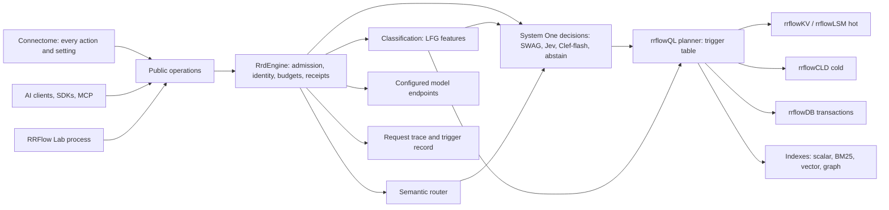

# RRFlow kernel contract

**Status:** active canonical engineering plan; supersedes seven planning records (listed at the end); the roadmap gates and the POA&M keep status authority
**Coordinate:** `rrflow://rrflow-instance/data/work-package/kernel-contract`
**Owner:** the one ordered engineering plan and the canonical schemas (S1 to S7) for RRFlow's development kernel; changes no gate, objective or POA&M status by itself
**Approved:** by the repository owner on 2026-11-13 ("yes"), as the single plan that replaces the competing ones
**Baseline:** engine `main` at `297bd98f`, Connectome at `19ee075c`, described in the [as-built baseline](../architecture/as-built-baseline.md)

## 1. What the owner asked for

The owner's words of 2026-11-13: "Connectome/RRFlow is all about the kernel of development". Classification, the System One controller and the semantic router "all work off the engine" with "clean boundaries and ways to fold in all of the proven optimizations". The system is "vibe coder proof while being enterprise supported", with "schema driven canonical consistency". QL "is pivotal and reacts to the context". LFG is rebuilt as "pure machine code" classification and a submodule, with "toggles for testing its limits". Connectome "must support every action configuration input". A development harness runs "tests with arango surrealdb and others". SWAG "weaves in and out for binary score choice", is "tunable and configurable with templates populated at install with suggested defaults", and "pod" toggles ensure "parallel running agents are never dealing with noise of multiple projects".

Earlier direction that still binds, from the records this plan replaces:

- Attunement is composed by the engine from evidence, never as a fixed sequence (2026-11-10).
- Access paths are chosen by reasoning need; cost is a budget, not the goal (2026-11-11).
- Hot first, cold when needed (2026-11-11).
- Nothing is hardcoded beyond best practice (2026-11-10).
- "Any test is useless unless the database, the CLD, the LSM and the reasoning engine are actually working" (2026-11-11).
- Effort grows reasoning cycles in one session, and Balanced targets 8–12 s by measurement (2026-11-11).
- The Lab is its own process in `crates/evaluation/lab/` (2026-11-12).
- RRFlow competes with "claude+jevdecisions" and "codex+chef flash" (2026-11-10). Those are Jev (TypeSafe AI) and Cloudflare Clef-flash, two System One decision models; see section 3.3.

## 2. The kernel and its boundaries

Rules:

- `RrdEngine` is the only authority.
- Classification, decisions and routing propose; the engine admits.
- Every component is reached through a configured binding, with no hardcoded provider, path or threshold.
- Exploratory reasoning stays adaptive ([ADR-0002](../decisions/0002-adaptive-reasoning-governed-effects.md)).

## 3. Canonical schemas

Each schema has one owner in `rrd-contract`. The JSON Schema, SDK types, Connectome forms, install templates and reference pages are generated from it, the way operations already are. The fields below are the contract the implementing package must meet. Their generated JSON Schemas are produced by that package, not written by hand here.

### 3.1 S1 Setting

One record per configurable input. This covers the engine, storage tiers, planner thresholds, LFG toggles, System One bindings, pods and Lab runs.

| Field | Meaning |
|---|---|
| `id` | Dotted path, for example `storage.lsm.compaction_trigger` or `ql.bm25.min_should_match` |
| `type`, `unit`, `range` | A typed value; a value out of range is refused |
| `default` | Suggested default with its evidence: `measured` (run id), `observed` (competitor probe), `literature` (citation) or `unmeasured` |
| `reload` | `live`, `next_open` or `rebuild` |
| `scope_ceiling` | The highest level that may set it: run, project, user, org or core (ADR-0005 order; ceilings only tighten) |
| `tier` | `basic`, shown to everyone, or `advanced`, shown on drill-down |
| `impact_rank` | From the Lab's ranking of settings (K3); empty until measured |
| `description` | One plain sentence a layman understands |

A change is a governed `configure-plan` with its diff and effects, then a `configure-apply` that returns a receipt. Resolution explains its source: `DEFAULT`, `INHERITED`, `OVERRIDE`, `CLAMPED`, `LOCKED` or `REFUSED`. **Install templates** are named sets of S1 values: `vibe-coder` (safe defaults, everything automatic), `developer` and `enterprise` (org ceilings, audit durability on). Installation previews the template and the person accepts or edits it.

### 3.2 S2 Classification observation (LFG)

| Field | Meaning |
|---|---|
| `feature` | For example `language`, `task_kind`, `complexity`, `modality`, `needs_retrieval`, `multi_hop` |
| `version` | Classifier and rule revision |
| `value`, `unit`, `range` | The observed value |
| `state` | `ok`, `missing`, `inconclusive` or `error`; never an invented value |
| `confidence` | Only when its calibration is declared; otherwise absent |
| `cost` | CPU time and bytes read |
| `enabled` | The S1 toggle for this feature (`lfg.features.<name>.enabled`) |
| `accuracy` | Per-feature precision and recall against graded labels from the harness (K3); empty until measured |

LFG never authorizes and never dispatches a model. The best published query classifier was right 54.5% of the time (Adaptive-RAG, 2024). Each feature therefore earns its weight only through its measured accuracy.

### 3.3 S3 System One decision

This aligns with the public System One decision API that Jev (TypeSafe AI, served on OpenRouter) and Cloudflare Clef-flash implement. SWAG, Jev, Clef-flash and a local model are interchangeable bindings of this one contract.

| Field | Meaning |
|---|---|
| `decision_point` | One of `retrieve_or_not`, `escalate_effort`, `stop_cycle`, `route_endpoint`, `read_cold`, `choose_path`, or a configured custom point |
| `state` | Engine-assembled input: the question digest, S2 features and the evidence summary so far |
| `question` | `noul` (yes or no), `choice` (one of a declared set), `score` (a number in range) or `box` |
| `answer` | Probabilities or score, plus `abstain` when uncertain or out of scope |
| `binding_id` | The configured endpoint that answered; latency and price recorded |
| `fallback` | The rule the engine applies on abstain, timeout or unavailability, named in S1 |

The engine asks only when the answer can change the plan, and records every question, answer and fallback. Clef-flash scored 66.77 on an out-of-scope test (vendor figure), so `abstain` and `fallback` are mandatory.

### 3.4 S4 Trigger table (rrflowQL planner)

The planner chooses paths by condition and records the matched row, the rejected rows and the reason. The observed column comes from the [planner probe](../evidence/planner-probe-20261113/README.md), in which ArangoDB 3.12 and SurrealDB 3.3 ran the same corpus and questions.

| Path | Triggered when | Threshold settings (S1) | Observed elsewhere |
|---|---|---|---|
| rrflowKV point read | identity or key predicate | none | both systems seek by key |
| Scalar or commit index | equality or range on an index's leading field, and the index watermark covers the read stamp | `ql.index.max_selectivity` (default 1.0, observed) | both kept the index at 100% selectivity on 909 rows |
| Full scan | no usable index | `ql.scan.max_keys` (default 100,000); a refusal names the budget | both full-scanned 17,021 records when no index existed |
| BM25 | text predicate or a context lexical stage | `ql.bm25.min_should_match` (default 1 term, OR-ranked; observed), `lexical.identifiers` | Arango ranks OR terms; Surreal's AND returned 0 rows for a sentence |
| Filter pushdown | a filter on an indexed field beside text or vector search | `ql.pushdown.enabled` (default on) | both pushed the crate filter into the text index; Surreal pushed it into HNSW; this put `rrd-lsm/src/database.rs` first |
| Vector | `NEAR` or a context semantic stage with an admitted embedding binding | `vector.recall_target` (default 0.95, owner decision of 2026-11-11), then cost within that target | Arango `use-vector-index`, Surreal `KnnScan` |
| Graph traversal | a relation question or seed expansion | `graph.max_depth` and `graph.max_width` (default 3 and 3, Think-on-Graph), relation weights | cost grows with edges touched: 17 reads at 1 hop, 37 at 2 |
| rrflowLSM hot | versions above the hot watermark | `storage.lsm.*` (today's constants become settings) | — |
| rrflowCLD cold | versions below the watermark, or knowledge paths, which default to cold | `storage.cld.watermark` (unmeasured) | — |
| rrflowDB transaction | mutation, or a read that needs multi-record consistency | `db.isolation` | — |
| System One question | a decision point listed in S3 | `swag.points.<point>.enabled` | neither system decides what to search; the caller's model does |

### 3.5 S5 Harness definition (RRFlow Lab)

| Field | Meaning |
|---|---|
| `corpus` | Pinned source revision and digest, for example this repository; larger corpora to reach scale thresholds |
| `questions` | At least 200, each with gold files or symbols, gold facts or keywords, and a category (lookup, lexical, relation, multi-hop, edit-context). Sources: SWE-QA and questions from this repository's own history (AugmentQA style) |
| `systems` | Database arms: RRFlow, ArangoDB, SurrealDB, Qdrant, Milvus. Stack arms: plain model, model + RRFlow context, Claude + Jev, Codex + Clef-flash. Each arm runs in its own container on pinned images |
| `answering_model` | The same configured model for every stack arm |
| `metrics` | Rubric-graded judge from a different provider than the answerer, gold-fact recall, recall@k, nDCG@10, p50 and p95 latency, tokens and cost per correct answer, with paired bootstrap intervals |
| `arms` | Always-maximum-effort against routed, because research shows routers match the expensive path's quality at lower cost but do not exceed it |
| `settings` | A sealed S1 set per run, with its digest recorded |
| `environment` | Host, CPUs, memory, other load, and the image digests |

### 3.6 S6 Project, engram, instance and pod

| Field | Meaning |
|---|---|
| `project` | The source root and its engram, one per project |
| `instance` | The process serving an engram |
| `pod.placement` | `shared` (one process serves several engrams) or `dedicated` (its own process) |
| `pod.cpu`, `pod.memory`, `pod.cache_bytes`, `pod.max_agents` | Budgets per pod |
| `links` | Explicit, read-only, audited cross-project links only (H-10, ADR-0005) |

Evidence, from the [SurrealDB multi-project probe](../evidence/surreal-projects-20261113/README.md): namespaces kept data and logins apart, but another project's writes raised one project's p95 from 1.7 ms to 6.8 ms and its worst case to 60 ms. A separate process kept p95 at 2.9 ms. `dedicated` is therefore the default for parallel agents; `shared` saves memory for idle projects. Lanes, budgets, enforcement and acceptance are in [code structure and conventions, section 4](../architecture/code-structure-and-conventions.md#4-pods-and-lanes).

### 3.7 S7 Synchronization

This is a full commercial capability (owner, 2026-11-13): read, write, edit and add across every kind of data, in both directions, started from whatever endpoint fires it. The design follows established practice:
- CouchDB and PouchDB replication: a changes feed, checkpoints per peer, and losing revisions that are kept;
- Couchbase Sync Gateway channels and PowerSync and Electric sync rules: selective scopes;
- ArangoDB DC2DC: datacenter-to-datacenter replication;
- CRDT libraries such as Automerge: conflict-free merges;
- OAuth 2.0 device authorization (RFC 8628): sign-in for desktop and CLI clients.

| Element | Contract |
|---|---|
| Replica identity | Every engram replica has a stable id: local install, cloud, or a team member's copy. Every change carries the replica id, a hybrid logical clock timestamp and a version vector |
| Triggers | One public operation family (`sync-start`, `sync-status`, `sync-stop`) behind every trigger: the Connectome sync button or keybinding, a CLI or AI client, a schedule (an S1 setting), continuous mode following the changefeed, and a team member pulling the team's scopes. The remote is a configured endpoint binding, never a hardcoded host |
| Scopes | Each scope names a kind and a direction (push, pull or both): project records, schema, settings, plans and receipts, the second brain (personal), and the org engram. Filters select what a device or member receives, as in sync rules. RBAC decides who may read or write each scope |
| Transport | An ordered, resumable change stream in idempotent batches keyed by (replica, sequence), with a checkpoint per peer and scope. Interrupted runs resume from the checkpoint and replays are harmless. Bandwidth and budget are settings |
| Conflicts | Detected when version vectors are concurrent, then resolved per kind. **Records:** a deterministic winner (later HLC, then replica id), with losing versions kept and shown in Connectome for review (CouchDB practice). **Settings:** per field, last writer wins, inside org ceilings, which always win. **Receipts and audit:** merged as a union, because they are append-only. **Schema:** a conflicting change is refused until resolved. **Second brain:** the owning user's replica wins. Every conflict is recorded with both sides |
| Authentication | A device key per installation, extending the existing install identity, plus an account sign-in through OAuth 2.0 device authorization for desktop and CLI. Requests use short-lived tokens over TLS, with mutual TLS for self-hosted and enterprise. Team and org RBAC decide access to each scope. Optional end-to-end encryption of scope contents for enterprise |
| Offline | Local work never waits for the cloud. Changes queue locally and sync when a trigger fires |

## 4. Packages, in order

The first package is a working skeleton: one end-to-end test that every later package must keep passing. Each package lands as one pull request, with its size advisory only ([#378](https://github.com/rrflow/rrflow-development/pull/378)). It is accepted by a real run on this repository, recorded in its journal. Connectome work ships with the engine package it shows, not later.

| Id | Package | Accepted when | Carries |
|---|---|---|---|
| K0 | **Working skeleton.** An installed engine on this repository takes a question through LFG (or a recorded "unavailable"), a System One decision (or abstain), the planner, storage and context, to a configured model, and the answer is graded. It is committed red first; each later package turns a stage green | the test runs in candidate CI and on the owner's machine, and the stage that fails is named | adaptive-design 7-step oracle; indexing package 6; one-engine first joined journey; second-mind step 4 exit; d02 P8 (Verify) |
| K1 | **Request trace and trigger record.** One correlation id through HTTP, engine, store and LSM; per-layer time; the S4 row matched and the rows rejected; a bounded in-memory ring; dev mode keeps the last N; optional OpenInference/OTel export, off by default | per-layer time sums to within 10% of wall time; tracing off adds no commit; under a memory ceiling latency is unchanged and drops are counted | J1, J12; second-mind step 4; indexing package 5 (traces) |
| K2 | **S1 settings and install templates.** Settings tree, resolver explanation, `configure-plan` and `configure-apply`; LSM constants and context weights move into settings; the `vibe-coder`, `developer` and `enterprise` templates; Connectome renders every setting from the schema | a live setting changes on a running install without reinstall; a refused value names its policy; Connectome shows every setting with no hand-written form | T1, J9, J2; joins decisions 1 and 3; one-engine decision 4; indexing "Configure KV, QL and DB"; POAM-077 |
| K3 | **S5 harness and baseline.** Lab adapters for ArangoDB and SurrealDB in Rust (the probe scripts become their characterization), the 200-question set, the judge, the stack arms, and settings ranking | one combined report: RRFlow against ArangoDB, SurrealDB, Qdrant and Milvus, plus the stack arms with a model; losses published | J10; d02 P10; T4, T5, T6; second-mind step 6; indexing "Observe and optimize"; the planner probe |
| K4 | **One planner with the S4 trigger table.** Commit indexes (done in #376), engine-maintained paths, `NEAR`, fusion as a plan operator, and context through the planner, dropping its own BM25, exact scan and BFS; scoped domain reads | context equals the planner at one stamp; keys examined proportional to the result; every result names its path and rejected paths; text questions under 100 ms warm | J3, J4, J5, J6; d02 P5, P7; T2; one-engine P5, P6; indexing package 4 |
| K5 | **Source knowledge.** Classification and domain proposal with the project map as a projection; relations (defines, references, imports, contains) and repository map; paging one file's facts across commits; dogfood repairs; embeddings through an admitted binding | "which files reference `control_attunement`" answered by traversal; `rrd-contract/src/lib.rs` parsed; an edit re-embeds only its chunks | d02 P2, P3 remainder, P4, P6, P9; J7; indexing packages 1–4; one-engine P4 |
| K6 | **Governed effects.** Job visibility, the effect plan and questions, one handoff schema (`one-engine-handoff-v1`; the other three shapes are retired), source identity, replan and fencing | the one-engine P1–P3 oracles; no duplicate effect across kill and replay | one-engine P0–P3; indexing package 5; adaptive "Durable execution" and "Developer handoff" |
| K7 | **Endpoints and System One.** S3 contract; protocol adapters (`openai.chat`, `openai.responses`, `anthropic.messages`, `systemone`, with `mcp.sampling` as advisory only); SWAG, Jev and Clef-flash bindings; a semantic-router producer; LFG becomes a binding; fixes for the unread worker adapter and the narrowed-routing validation defect | the same question runs with each System One binding and the receipt names it; an unknown adapter is refused | one-engine P8; d02 P9 (bindings); `lfg-swag.md`; baseline section 1 |
| K8 | **LFG classification submodule.** Machine-code classifier implementing S2, with per-feature toggles and limit tests; added as a credential-free submodule (the repository is public as of 2026-11-13) | per-feature accuracy reported by K3; toggling a feature changes only that feature's input; CPU budget held | owner direction of 2026-11-13; second-mind developer tools |
| K9 | **Reasoning cycles by effort.** Quick, Balanced, Thorough and Custom; each cycle is one planner request at one stamp; stopping by a calibrated or learned policy (Stop-RAG) using the S3 `stop_cycle` point; preferences fetched in their own recorded step | more effort raises measured quality until it flattens; Balanced p50 near 8 s and p90 ≤ 12 s if quality flattens there; replay identical; budget held across restart | J11; T3; joins decision 4 |
| K10 | **Storage made real and tuned.** Byte breakdown of the store (236 MB for 7.2 MB of source, 33×, against about 3× for Zoekt); parse throughput (1.7–2.5 files/s); hot then cold at one stamp with a versioned CLD reader (Parquet generation first, custom format later from measured access); LSM against Fjall; C-07; transactional conformance; SQL aggregates | each tier's bytes reported; hot, cold and retained reads agree across update, delete, interruption and restart; a cold-on/cold-off comparison at each effort | J8; second-mind steps 2 and "cold storage may never be needed"; one-engine P9; d02 P12; F-03; indexing embedded-columnar direction |
| K11 | **Instances, pods and second brain.** S6; resource-managed instances; pod placement toggles; personal and org engrams with linked reads | parallel agents on two projects show no cross-project latency rise beyond a declared tolerance in `dedicated`; a link read is audited | H-06, H-07, H-10, H-11; ADR-0005; Surreal multi-project evidence |
| K12 | **Connectome kernel UI**, under the [code structure and conventions](../architecture/code-structure-and-conventions.md) (feature folders, arktype schemas generated from the engine, devkit, ratchets). TanStack file-based routes replacing wouter; generated settings forms; trigger and trace visual; reasoning-graph replay; second-brain neural visuals on a pre-made SVG art library; active instances and pods; Lab routes; client repinned to engine `main`; inherited SurrealDB-era views re-authored or retired | every K-package setting and action is reachable in the UI; the trigger record of a real question is shown; the visual-parity rule holds | T7; second-mind steps 3, 8, 9; baseline section 6 |
| K13 | **Repository convergence**, continuous, starting with the enforcement ratchets and file splits in the [code structure and conventions](../architecture/code-structure-and-conventions.md). Fragmentation from the baseline (the unused `rrd-maintenance`, the cluster, Kubernetes and pgvector scope decision, lab crate merges, Python duplicates, `sha256_hex` copies, workspace lists, stale `rrflow-eval` docs); the estate-to-engram rename; delivery | each removal keeps every test; one owner per concept | baseline section 8; d02 P11; one-engine P0, P10 |
| K15 | **Cloud tier and synchronization.** The local engram synchronizes with the cloud offering, which is comparable to SurrealDB Cloud or ArangoDB's managed service and backed by shippinAI. `rrd-cluster` provides replication; `rrd-kubernetes` deploys it for shippin.cloud; the shippin panel manages it. Optional and feature-gated, consuming only public engine contracts, never required for local readiness | implements S7: two replicas and a team member's replica converge after concurrent edits, deletes, schema changes, interruption and reconnect, from every trigger; each conflict kind resolves by its S7 rule and is recorded; a member without a scope's grant never receives it; the shippin panel reads the same contracts | owner direction of 2026-11-13; the roadmap's optional enterprise control plane; `rrd-cluster`, `rrd-kubernetes`, pgvector adapter |
| K14 | **Second-mind extensions**, after K3 shows a working baseline. Honesty layer and lexicon on the 743 saved prompts; connectors and importers (ArangoDB, SurrealDB, MongoDB, Atlassian); external harness import; UI library within render and memory budgets | each with its own real-run exit from the second-mind ledger | second-mind steps 7, 8, 10 |

Order: K0, then K1, K2, K3, K4. K5, K6 and K7 follow; K7 can start once K2 has landed. K8 needs K3 and K7. K9 needs K4 and K7. K10 starts its measurement after K1 and K3, with the CLD move last. K11 follows K2 and K3. K12 ships with each package. K13 is continuous, and K14 comes after K3's baseline. K15 starts after K4 and K10, once the local engine's planner and storage tiers are measured, because synchronization replicates them.

## 5. Contradictions resolved

1. **Identifiers.** Packages are K0–K14. The old P, J and T ids appear only in the "Carries" column.
2. **What comes first.** The working skeleton, then the trace. The superseded records disagreed (instrumentation first, slice first, or CLD first).
3. **CLD format.** The 2026-11-11 decision stands: a versioned reader, the Parquet generation first, and the custom format from measurements.
4. **Lab location.** `crates/evaluation/lab/`. The `eval/lab` paths in older records are stale.
5. **Comparison set.** ArangoDB, SurrealDB, Qdrant and Milvus, plus the Claude + Jev and Codex + Clef-flash stack arms.
6. **Lexical acceptance.** All three bars apply: exact equality with a full rebuild, keys proportional to the result, and under 100 ms warm.
7. **Handoff schema.** `one-engine-handoff-v1` is the one schema; the other shapes are historical.
8. **PR size.** Advisory only.
9. **Rejected owner direction.** The owner withdrew the DuckDB adapter direction, and pgrust (AGPL-3.0) is study only.

## 6. Owner decisions still open

Each has a default this plan proceeds with unless the owner says otherwise.

| Decision | Default |
|---|---|
| Judge model and spending limit for answer quality (open since 2026-11-03) | none chosen: K3 reports retrieval metrics and latency until the owner names a judge and limit |
| First local embedding backend | fastembed (ONNX) behind its feature flag |
| Hardware and placement for comparisons | this laptop for development runs; one GB10 Spark arm for recorded runs, with the owner's per-run approval |
| Domain thresholds (minimum files, dominant-language share) | a workspace member is always a domain; the other thresholds come from K3 |
| Identifier tokenizer | whole-and-parts (shipped in #376) |
| When the estate-to-engram rename happens | inside K13, after K4 |
| Atlassian scope (Jira, Confluence or both) | asked when K14 starts |
| Connectome parking lot 008 as the A2UI design | asked when K12 reaches A2UI |
| Global configuration operations (owner, admission, grant) | defined by K2 |
| Pre-release installed v2 plans and jobs | reinstall for pre-release; no migration lane |

## 7. Superseded records

These stay readable as history. Their packages are carried by the "Carries" column above.

- [D-02 evidence-driven attunement plan](d02-evidence-driven-attunement-engineering-plan.md)
- [Installed project indexing plan](rrflow-1.0/project-indexing-execution-plan.md)
- [Adaptive developer build design](rrflow-1.0/adaptive-developer-build-design.md)
- [Second-mind program](second-mind-program.md)
- [One-engine execution plan](../architecture/one-engine-execution-plan.md)
- [One-engine joins plan](one-engine-joins-engineering-plan.md)
- [Tunable reasoning and Lab plan](tunable-reasoning-and-lab-engineering-plan.md)

The [E-04 TurboQuant persistent serving plan](e04-turboquant-persistent-serving-engineering-plan.md) stays active as the detailed plan for vector paths inside K4.
